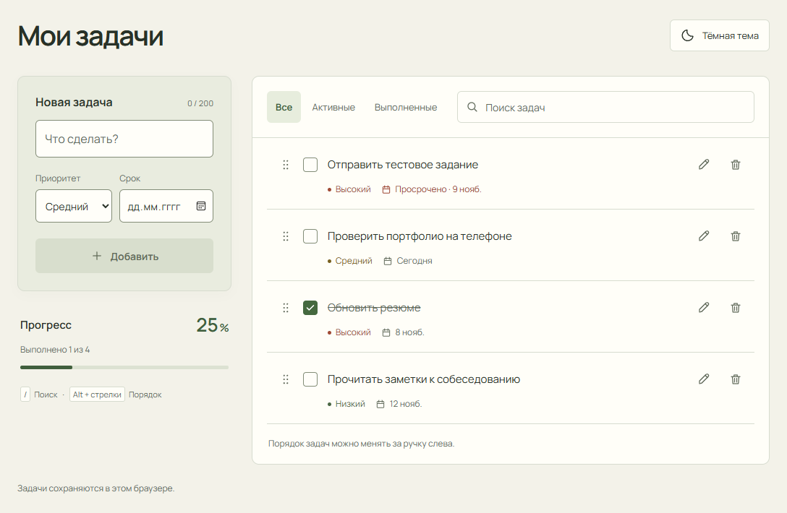

# Мои задачи · V2

Адаптивный список повседневных дел на React. Задачи остаются в вашем браузере; регистрация, сервер и внешние API не нужны.



## Возможности

- Добавление кнопкой или Enter, проверка пустого ввода, названия до 200 символов.
- Выполнение, возврат в активные и удаление с короткой анимацией.
- Редактирование прямо в списке, сохранение Enter и отмена Escape.
- Три приоритета и календарный дедлайн: назначение, изменение, удаление, отметка просрочки.
- Перестановка мышью, касаниями и клавиатурой через dnd-kit.
- Поиск на русском и английском вместе с фильтрами «Все / Активные / Выполненные».
- Общий прогресс: выполнено / всего, процент и шкала.
- Светлая и тёмная темы, системный выбор при первом открытии, сохранение настройки.
- Адаптивный интерфейс, видимый фокус и поддержка reduced motion.
- Совместимость с задачами V1 и обработка ошибок localStorage.

## Технологии

React, Vite, JavaScript, CSS, HTML, localStorage. Для перетаскивания используется современный `@dnd-kit/react` с `@dnd-kit/dom`. UI и анимации оформлены собственным CSS. Шрифт Manrope размещён локально; его [лицензия OFL](public/fonts/OFL.txt) включена в проект.

[Лицензии библиотек](public/THIRD_PARTY_NOTICES.txt) включены в production-сборку.

## Установка и запуск

Нужен Node.js 22.12+; рекомендуется Node.js 24 LTS.

```sh
npm install
npm run dev
```

## Production-сборка

```sh
npm run build
npm run preview
```

Готовый сайт — папка `dist/`. Открывайте его через HTTP-сервер, например командой preview. Для Netlify уже заданы `npm run build` и `dist` в `netlify.toml`.

## Сохранение и темы

Список хранится под прежним ключом `todo-list.tasks.v1`. Старые идентификаторы, статусы и порядок сохраняются; недостающие свойства получают `priority: medium` и `dueDate: null`. Перед первой записью перенесённого списка создаётся резервная копия в `todo-list.tasks.v1.backup`. Порядок — это положение задач в массиве.

Тема хранится отдельно в `todo-list.theme` и применяется в HTML до загрузки React. Если выбора ещё нет, используется системная тема. При запрете localStorage приложение работает в текущей вкладке и сообщает об ограничении сохранения. Данные не синхронизируются между устройствами; очистка данных сайта удаляет локальный список.

## Клавиатура

| Клавиша                          | Действие                                             |
| -------------------------------- | ---------------------------------------------------- |
| Enter в новой задаче             | Добавить                                             |
| Enter / Escape в редакторе       | Сохранить / отменить                                 |
| `/` вне полей ввода              | Перейти к поиску                                     |
| Escape в поиске                  | Очистить запрос; повторно — выйти из поля            |
| Alt + вверх / вниз на ручке      | Переместить задачу на одну позицию                   |
| Пробел на ручке, стрелки, пробел | Захватить, переместить, подтвердить; Escape отменяет |

Порядок изменяется в режиме «Все» с пустым поиском. Для сенсорного перетаскивания удерживайте ручку около 220 мс; остальная поверхность списка сохраняет обычную прокрутку.

## Проверки

```sh
npm run lint
npm run build
npx playwright install firefox webkit
npm test
```

На Windows тесты Chromium используют установленный Microsoft Edge. Если его нет: `npx playwright install msedge`. На macOS/Linux дополнительно нужен `npx playwright install chromium`. [TESTING.md](TESTING.md) содержит фактические результаты, размеры экранов и ограничения проверки.

## Использование AI

Проект доработан с OpenAI Codex. AI применялся для анализа существующего кода и референсов, реализации интерфейса и новых функций, подготовки браузерных тестов, изучения скриншотов и документации. Автотесты действительно запускались; детали приведены в TESTING.md. Внутри приложения AI-сервисы не используются.

## Демо и материалы

Исходный код: [GitHub — ssvoboka/todo-list-react](https://github.com/ssvoboka/todo-list-react).

Публикация демо на Netlify подготавливается. Настройки и порядок обновления описаны в [DEPLOYMENT.md](DEPLOYMENT.md). Пароли и токены в проект не добавлялись.

[Объяснение для собеседования](PROJECT_EXPLANATION.md) · [Тёмная тема](docs/preview-dark.png)
